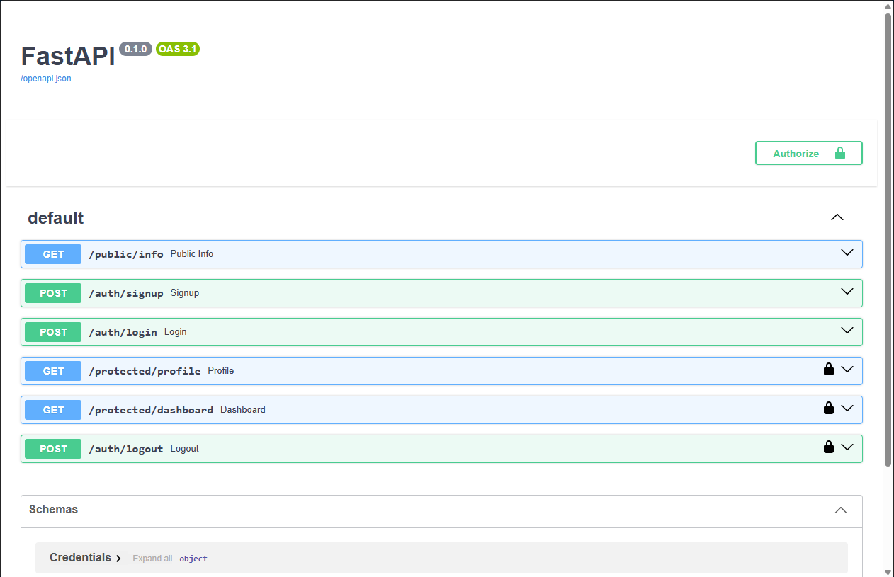

# FastAPI Auth API with Supabase

A secure backend API built with **FastAPI** that uses **Supabase Auth** as its Identity Provider. Users can sign up, log in and log out, and certain routes are protected so they only answer to requests carrying a valid JSON Web Token (JWT).

The server never stores or hashes passwords. It forwards credentials to Supabase, receives a signed JWT back, and verifies that token with Supabase on every protected request through a single reusable dependency.

Built for the FlyRank Internship, Backend Track, Week 2 (Assignment A4: Auth · Login & protect).

## How it works

1. The client sends an email and password to `/auth/login`. The server passes them to Supabase.
2. Supabase returns an access token (JWT) and a refresh token.
3. The client calls a protected route with `Authorization: Bearer <access_token>`.
4. The server asks Supabase whether the token is real (`get_user`). If it is, the route runs. Otherwise the server answers `401`.

## Tech stack

- Python 3.10+
- FastAPI and Uvicorn
- Supabase (`supabase` Python SDK) for authentication
- `python-dotenv` for configuration

## Setup

### 1. Clone and install

```bash
git clone https://github.com/nyhalraza/auth_login_supabase.git
cd auth_login_supabase

python -m venv venv
# macOS / Linux
source venv/bin/activate
# Windows (PowerShell)
venv\Scripts\Activate.ps1

pip install -r requirements.txt
```

### 2. Create a Supabase project

1. Create a free project at [supabase.com](https://supabase.com) (no credit card needed).
2. In **Authentication → Sign In / Providers → Email**, turn **Confirm email OFF** so a new account can log in right away. (Leave it on in production.)
3. Copy your **Project URL** (shown on the project Overview page or under the **Connect** button) and your **anon / publishable key** (**Project Settings → API Keys**).

> Never use the `service_role` or secret key in this project. It bypasses all security.

### 3. Configure environment variables

Copy the example file and fill in your own values:

```bash
# macOS / Linux
cp .env.example .env
# Windows
copy .env.example .env
```

| Variable       | Description                                  |
| -------------- | -------------------------------------------- |
| `SUPABASE_URL` | Your Supabase Project URL                    |
| `SUPABASE_KEY` | Your Supabase anon (publishable) key         |
| `PORT`         | Port the server runs on (default `8000`)     |

`.env` is listed in `.gitignore` and is never committed.

## Run

```bash
uvicorn myapi:app --reload --port 8000
```

The API is now at `http://localhost:8000` and the interactive docs are at `http://localhost:8000/docs`.

## API reference

| Method | Path                  | Auth required?   | Success | Description                                  |
| ------ | --------------------- | ---------------- | ------- | -------------------------------------------- |
| POST   | `/auth/signup`        | No               | 201     | Create a new user account                    |
| POST   | `/auth/login`         | No               | 200     | Log in and receive access and refresh tokens |
| POST   | `/auth/logout`        | Yes (Bearer JWT) | 204     | End the session                              |
| GET    | `/protected/profile`  | Yes (Bearer JWT) | 200     | Return the current user's id, email, created date |
| GET    | `/protected/dashboard`| Yes (Bearer JWT) | 200     | Example second protected route (reuses the same guard) |
| GET    | `/public/info`        | No               | 200     | Public message, open to everyone             |

### Request bodies

`POST /auth/signup` and `POST /auth/login`:

```json
{
  "email": "you@example.com",
  "password": "your-password"
}
```

### Login response

```json
{
  "access_token": "eyJ...",
  "refresh_token": "..."
}
```

### Calling a protected route

```bash
curl -i http://localhost:8000/protected/profile \
  -H "Authorization: Bearer <your_access_token>"
```

### Error responses

Every error returns JSON in the shape `{ "error": "<message>" }`.

| Status | When                                                        | Message                          |
| ------ | ----------------------------------------------------------- | -------------------------------- |
| 400    | Email or password missing on signup/login                   | `Email and Password Required`    |
| 401    | Wrong email or password on login                            | `Invalid login credentials`      |
| 401    | Authorization header missing, malformed, or not `Bearer`    | `Access token required`          |
| 401    | Token is tampered with, invalid, or expired                 | `Invalid or expired token`       |

## Swagger UI

FastAPI serves Swagger UI at `/docs`. Protected routes show a padlock. Click **Authorize**, paste the access token (without the `Bearer ` prefix), then use **Try it out**.



## Project structure

```
.
├── myapi.py            # FastAPI app: routes and auth dependency
├── requirements.txt    # Python dependencies
├── .env.example        # Template for environment variables
├── .gitignore          # Keeps .env and venv out of Git
├── swagger.png         # Swagger UI screenshot
└── README.md
```

## Design notes

- **Reusable guard.** Token checking lives in one dependency, `get_current_user`, applied with `Depends(...)` to every protected route. Routes never contain their own auth code, so a door can't be forgotten.
- **Verified by Supabase.** The server calls `supabase.auth.get_user(token)`, which checks the token with Supabase over the network. Invalid tokens and failed calls both produce a `401`.
- **Logout is stateless.** JWTs are not tracked by the server, so an access token already issued keeps working until it expires (about one hour by default), even after `/auth/logout`. This is a known trade-off of stateless tokens.
- **Missing fields return 400.** Request fields are optional in the Pydantic model and validated manually, so a missing email or password returns `400` instead of FastAPI's default `422`.
- **No secrets in the repo.** Keys live in a git-ignored `.env`. Only `.env.example` with placeholders is committed.

## Testing on Windows PowerShell

In PowerShell, use `curl.exe` (plain `curl` is an alias for another command), and send JSON from a file to avoid quoting problems:

```powershell
curl.exe -i -X POST http://localhost:8000/auth/login `
  -H "Content-Type: application/json" `
  -d "@login.json"
```

Or use Swagger UI at `/docs`, which avoids shell quoting altogether.
